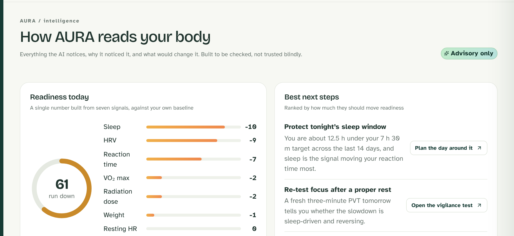
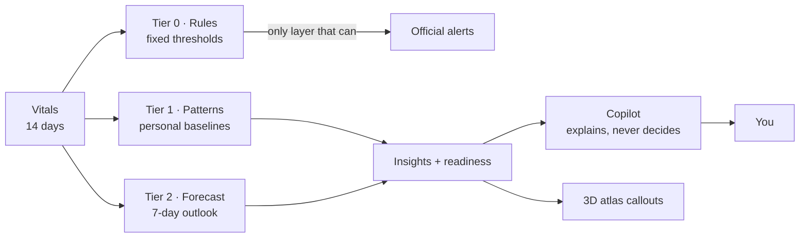
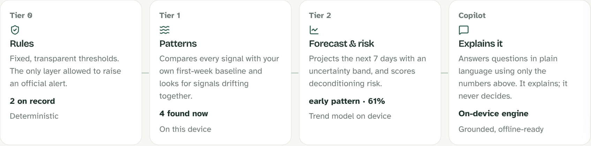
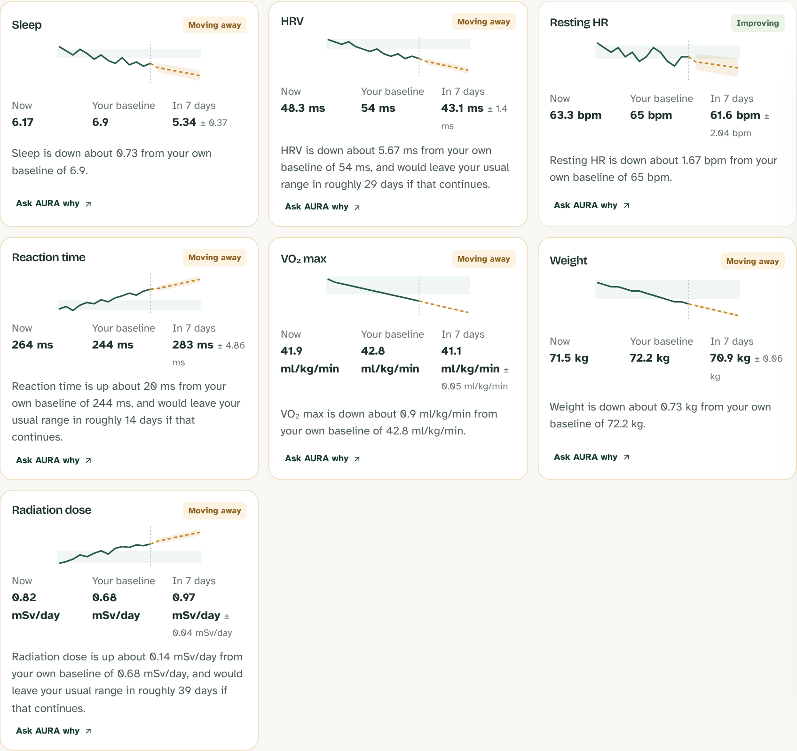
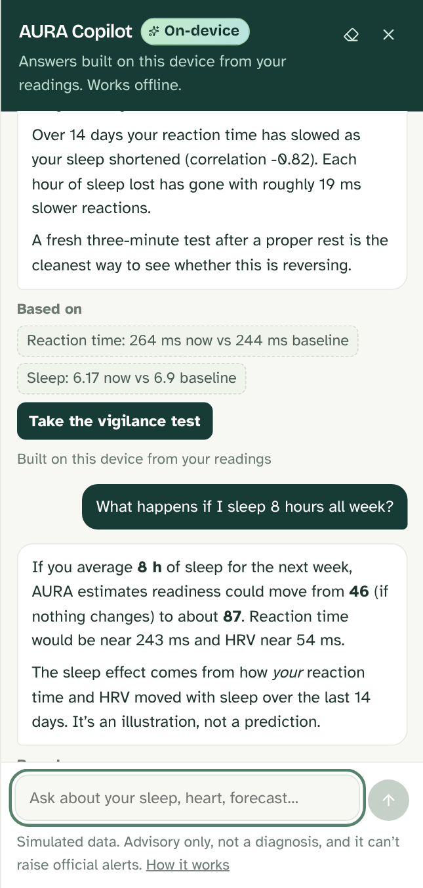
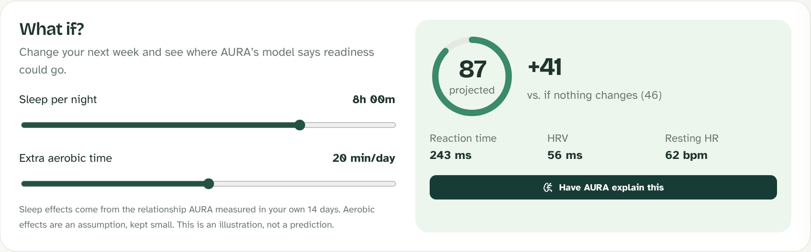
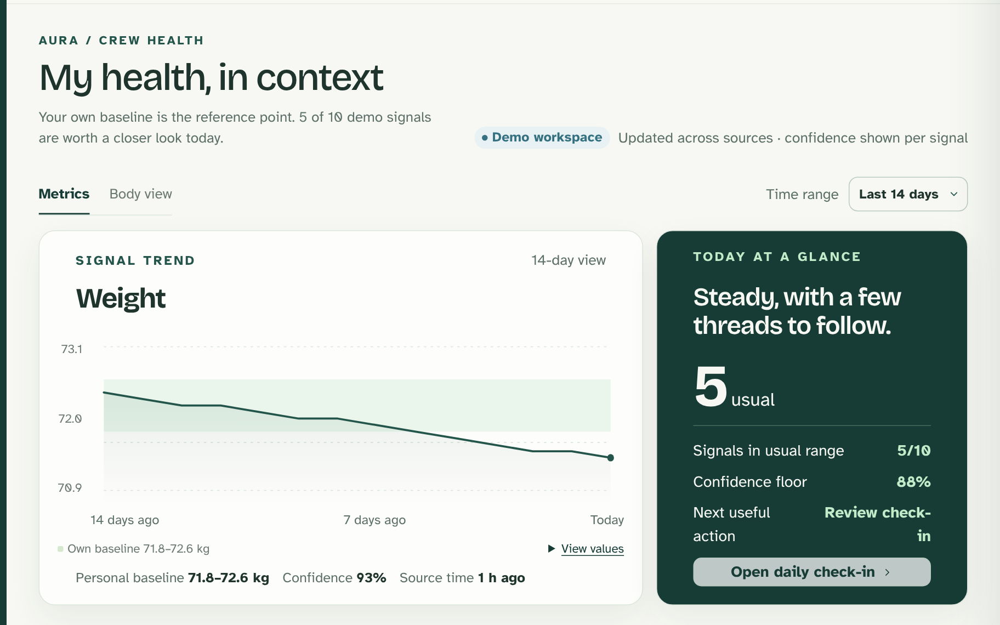

<div align="center">

# AURA · AstroVitals

### A health workspace for crews who live far from Earth, with an AI that explains itself.

An interactive, local-first prototype that pairs a **real 3D human-anatomy atlas** with an **on-device AI** (and an optional live Claude copilot) to turn a stream of vitals into plain-language understanding, honest forecasts and a clear next step.


**[Quick start](#quick-start)** · **[What's inside](#whats-inside)** · **[The AI](#aura-intelligence--the-ai)** · **[The 3D atlas](#the-3d-atlas)** · **[Configuration](#configuration)** · **[Deploy](#deploying)** · **[Documentation PDF](docs/AURA-AstroVitals-Documentation.pdf)**

</div>

> **This is a demonstration, not a clinical system.** Every reading is simulated, nothing is transmitted, and the AI is advisory only. Do not enter real patient or astronaut data. See [Safety and honesty](#safety-and-honesty).

---

## Why it exists

On a long mission a crew member can't pop down the road to a clinic, and the signals that matter (sleep, recovery, reaction time, radiation, fitness) drift slowly and quietly. AURA explores what a calm, trustworthy health companion could look like in that setting:

- **Your own baseline is the reference**, not a population average.
- **The AI shows its working.** Every finding names the numbers behind it, and every layer of the system is labelled for what it is.
- **Rules and AI never blur.** Only transparent threshold rules can raise an official alert. The AI explains, forecasts and suggests; it never decides.
- **The body is the interface.** Findings are pinned to real anatomy you can orbit, zoom and open.

## Quick start

Requires **Node.js 22.12+** (Node 24 recommended).

```bash
npm ci
npm run dev        # http://localhost:3000
```

| Command | What it does |
| --- | --- |
| `npm run dev` | Dev server on port 3000, including the local copilot API |
| `npm run build` | Type-checks, then builds to `dist/` |
| `npm run preview` | Serves the production build |
| `npm run lint` | Runs oxlint |

The app uses hash routing, so it runs on any static host: `http://localhost:3000/#/intelligence`.

> **3D models:** the Human-Atlas files live in `public/models/` (about 70 MB across three sets). Keep that folder in place. Without it the app still works and shows a small built-in body instead of the atlas.

### Turn on the live Claude copilot (optional)

The copilot works fully offline with no setup. To have answers written by Claude instead:

```bash
cp .env.example .env.local
# edit .env.local and set ANTHROPIC_API_KEY=...
npm run dev
```

The badge in the copilot header changes from **On-device** to **Claude · live**. The key stays on the server and never reaches the browser.

---

## What's inside

| Area | Route | What you get |
| --- | --- | --- |
| **Overview** | `#/` | AI hero (readiness, drivers, patterns, ask box) beside the 3D atlas, daily tasks, alerts, care links |
| **AURA Intelligence** | `#/intelligence` | How the AI reads you: readiness, next steps, the four layers, body findings, signal forecasts, patterns, what-if simulator |
| **My health** | `#/dashboard` | Metric detail, baselines, 7/14-day views, hazard filters, confidence and source time |
| **Body view** | `#/body` | The full atlas with angle, zoom, layer and AI-overlay controls |
| **Alerts** | `#/alerts` | Official rule alerts, advisory AI patterns (each with *Explain with AURA*), reminders |
| **Check-in & tests** | `#/checkin`, `#/pvt` | Four-step check-in; three-minute reaction-time test |
| **Exercise** | `#/exercise` | Equipment context, timers, sets, RPE, completed/partial records |
| **Training room** | `#/games` | Four short games: Fuel the crew, Load bearing, Keep the clock, Fact from fiction |
| **Care** | `#/support`, `#/crew`, `#/medical-event` | Local support notes, crew directory, validated medical-event documentation with JSON export |

Press **Ctrl/Cmd + K** to search, **Ctrl/Cmd + J** (or **/**) to ask AURA from anywhere.



---

## AURA Intelligence — the AI

AURA's AI is built as four layers that are kept deliberately separate, so you always know what produced a statement.





### The on-device engine — `src/ai/engine.ts`

Deterministic, offline, and cheap enough to run on every render. From the simulated 14-day series it produces:

- **Personal baselines**: median and MAD of your first week, so "normal" means *your* normal.
- **Drift scores and trends**: how many baseline-spreads each signal has moved in the worse direction, plus a least-squares slope.
- **7-day forecasts** with an empirical uncertainty band that widens with the horizon, and "days until you leave your usual range".
- **Cross-signal patterns**: for example *reaction time is following your sleep* (with the correlation) and *a recovery debt is building* (sleep, HRV and resting heart rate moving together).
- **Readiness (0–100)** with named drivers, so the number is never a black box.
- **A personal response model** fitted on your own sleep, reaction-time and HRV data, used by the what-if simulator.



### The copilot — **Ask AURA**

Open it from the floating button, `Ctrl/Cmd + J`, or `/`. Every answer shows **"Based on"** chips with the exact readings used and action buttons that jump to the right screen. Emergency wording is never answered clinically: it points to official procedures and your Medical event page.

<p align="center"></p>

Two answer paths share one interface:

| Path | When | How |
| --- | --- | --- |
| **On-device** | Always available, works offline | `src/ai/copilot.ts` routes the question to a grounded answer built from the engine's findings |
| **Claude · live** | When `ANTHROPIC_API_KEY` is set on the server | `api/copilot.ts` streams a Claude answer grounded on the same compact readings JSON |

The serverless endpoint (`api/copilot.ts`):

- `GET /api/copilot` returns `{ "configured": true | false }`, so the UI knows which mode to show.
- `POST /api/copilot` takes `{ messages, context }` and streams plain text. Inputs are length-limited, only the last ten turns are sent, and the system prompt forbids diagnosis, invented numbers and alert creation.
- Optional `COPILOT_ALLOWED_ORIGIN` restricts which origin may call it.
- With no key, or on any error, the app silently falls back to the on-device engine.

### What-if simulator

Change next week's sleep and aerobic time and see projected readiness, reaction time, HRV and resting heart rate against "if nothing changes". The sleep effect is fitted from *your* data; the aerobic effect is a small, clearly labelled assumption.



---

## The 3D atlas

The Body view shows real Human-Atlas anatomy, not a schematic figure: the male **BodyParts3D** body (2,234 structures), the female **Human Reference Atlas** body, and the **Visible Human Female** leg-muscle set. Models stream as gzip binary chunks on demand, mount as zero-copy typed arrays and render in a handful of draw calls while every structure stays individually addressable.

- **Immersive stage**: a dark observatory with glass platform, tick ring, drifting dust, a slow scan sweep, floor glow and vignette (switched off by *Reduce motion*).
- **Starts close**: head to hips, so organs and findings are readable immediately.
- **Controls** (`#/body`): angle (front, 3/4, side, **back**), zoom presets (upper body, torso, head, legs, full body), layers (**See inside** hides the muscle layer; **With muscle** shows everything) and an **AI findings** overlay.
- **AI on the anatomy**: callouts are pinned to the heart, brain, lymphatic nodes and skeleton, follow the camera, and open the matching system when tapped. Hovering a system in the index brings it forward.
- **Interaction**: drag to orbit, scroll or pinch to zoom, hover a structure for its name, tap to bring its system forward.

Key files: `src/components/body/anatomyEngine.ts` (engine), `AtlasBodyScene.tsx` (maps AURA systems to atlas systems, pins callouts), `AtlasStage.tsx` (hero and Intelligence stage), `presets.ts` (framings, views, layers), `src/lib/anatomy/` (data loading). Model credits and licences: [ATTRIBUTION.md](ATTRIBUTION.md).

If the atlas files can't open (not installed, or no WebGL2), `BodyTwin.tsx` provides a lightweight built-in 3D body so there is always something to orbit.

---

## Readable by design

- **Larger text throughout**: every font size is rem-based with a comfortable minimum, so nothing important is tiny.
- **Text size control**: *Profile → Text size* offers Standard, Large and Extra large, scaling the whole interface and remembered between visits.
- Kumbh Sans for body text, high-contrast tokens, visible focus rings, dialog focus trapping, Escape-to-close, keyboard-reachable 3D labels, `aria-live` copilot answers, and a **Reduce motion** setting that also respects the OS preference.



---

## Configuration

| Variable | Where | Purpose |
| --- | --- | --- |
| `ANTHROPIC_API_KEY` | Server / `.env.local` | Enables the live Claude copilot. **Never** prefix with `VITE_`. |
| `ANTHROPIC_MODEL` | Server | Model for the copilot. Defaults to `claude-sonnet-5-5`. |
| `COPILOT_ALLOWED_ORIGIN` | Server | Optional. Only this origin may call `/api/copilot`. |
| `VITE_COPILOT_ENDPOINT` | Build time | Optional. Point the UI at a different copilot URL. |

The optional Tier 0/1/2 backend is configured in `src/api/`. Without it the app uses a labelled fallback snapshot. See [.env.example](.env.example).

## Deploying

The app is a static single-page build plus one optional serverless function.

- **Vercel (recommended)**: import the repo, framework *Vite*. `api/copilot.ts` is picked up automatically as a function. Add `ANTHROPIC_API_KEY` under *Environment Variables* to enable live mode.
- **Any static host**: run `npm run build` and serve `dist/`. Hash routing needs no rewrites. The copilot stays on-device unless you host the function elsewhere and set `VITE_COPILOT_ENDPOINT`.
- Make sure `public/models/` ships with the build; it is not generated.

## Project structure

```text
api/
  copilot.ts              Serverless copilot endpoint (GET status, POST stream)
src/
  ai/
    engine.ts             On-device analysis: baselines, forecasts, patterns, readiness, what-if
    copilot.ts            Grounded local answers, live streaming client, status probe
  api/                    Backend contract, client and adapters (optional live backend)
  components/
    ai/                   Copilot panel + launcher, AI hero, readiness ring, badges
    body/                 Atlas engine, atlas scene/stage, presets, callouts, fallback twin
    ui/                   Accessible primitives and charts
    AppShell.tsx          Navigation, search, profile + text-size settings
  data/                   Clearly simulated vitals, games and medical content
  hooks/                  useAura (backend), useIntelligence (AI context)
  lib/anatomy/            Atlas manifest types, loading, layout
  pages/                  Route screens (+ games/)
  stores/                 Zustand: crew, settings, app workflows, copilot
  styles/                 design-system.css (tokens), ai.css, page styles using CSS @scope
public/models/            Human-Atlas geometry (manifests + .bin.gz chunks)
_technical_support/       Verification scripts and diagnostic evidence
docs/                     Screenshots, documentation PDF, previous README
```

## Verifying changes

```bash
npx tsc --noEmit && npm run build && npm run lint
```

`_technical_support/ai-verification/` contains Playwright scripts used during development: a smoke test, a text-size and overflow sweep over every route, and a stand-in atlas generator that exercises the 3D code without the large model files. `_technical_support/aura-integration/` holds the mock backend and adapter tests.

## Safety and honesty

- **Everything is simulated.** Vitals, baselines, thresholds, forecasts, risk and confidence are illustrative. Crew profiles share the demo dataset.
- **AI is advisory.** It never diagnoses, prescribes, creates alerts or claims clinical accuracy. Support percentages describe how strongly data backs a *pattern*, not the probability of illness.
- **Local storage is not clinical storage.** Check-ins, exercise, PVT results, notes and preferences live unencrypted in your browser. Don't enter real patient data.
- **Nothing is sent anywhere** except, when you enable live mode, the compact simulated readings and your question to the copilot function.
- The Earth communication delay is simulated; no clinician availability or treatment approval is claimed.

## Browser support

Current Chrome, Edge, Safari or Firefox with CSS `@scope`, WebGL2 and `DecompressionStream` for the full atlas. Without them the app degrades gracefully to the built-in body.

## Credits

- Anatomy: BodyParts3D (CC BY 4.0), Human Reference Atlas / HuBMAP (CC BY 4.0), Visible Human Female leg muscles (CC BY 4.0). Details in [ATTRIBUTION.md](ATTRIBUTION.md).
- Type: Bricolage Grotesque and Kumbh Sans via Fontsource.
- Built with React, Vite, Three.js, Zustand, Framer Motion and Lucide.
- The optional copilot uses Claude by Anthropic.

---

<div align="center">

**Far from Earth. Never on your own.**

</div>
